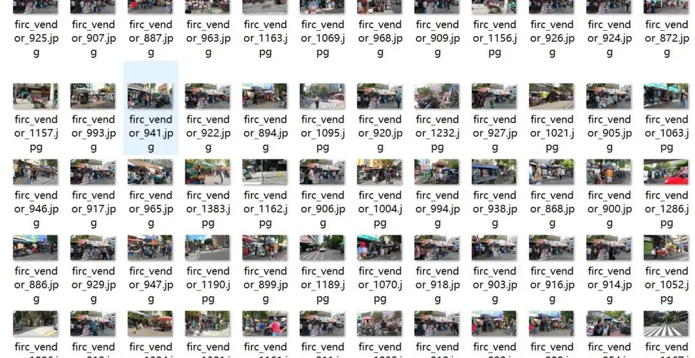
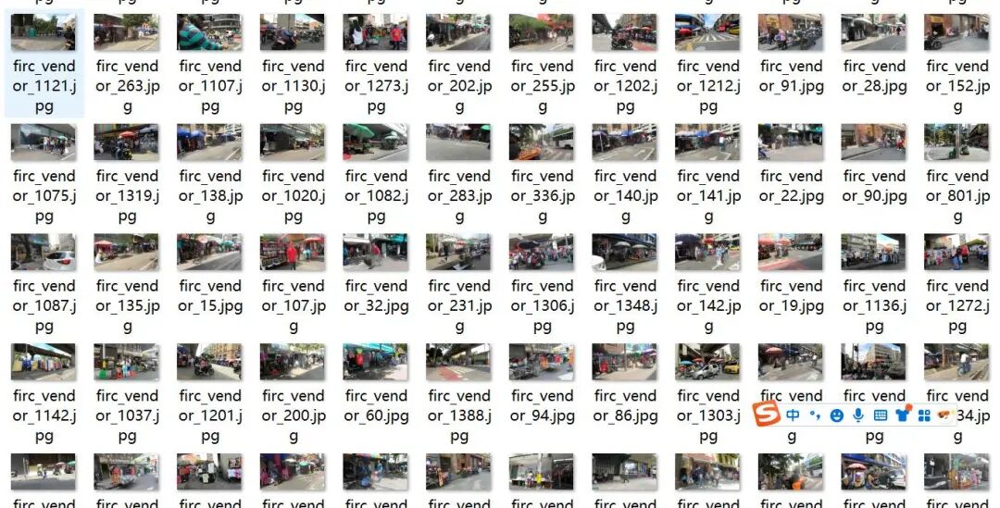
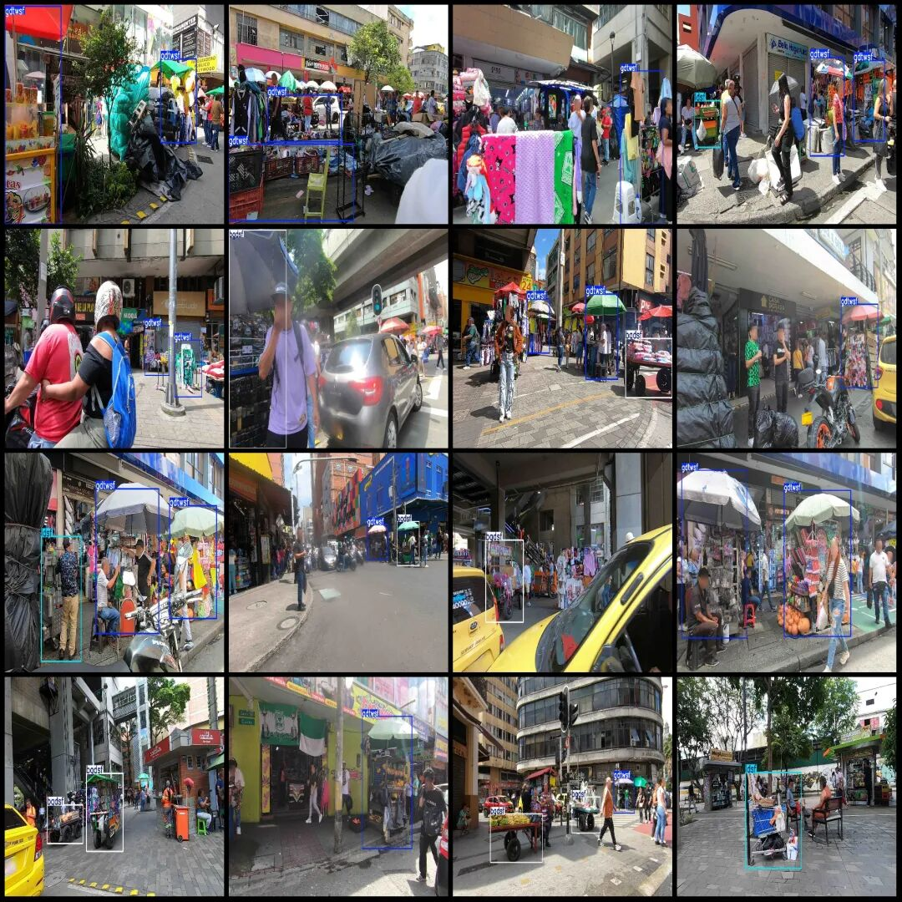

# Flowing street vendors occupying road space, street vending detection dataset in VOC+YOLO format with 1396 images across 3 categories

Note: The dataset faces have undergone desensitization, with all being obscured.

Dataset format: Pascal VOC format + YOLO format (txt file without split path, only containing jpg images and corresponding VOC format xml files and yolo format txt files)

Number of images (number of jpg files): 1396

Number of annotations (number of xml files): 1396

Number of annotations (number of txt files): 1396

Label category count: 3

Label category names (note that the order of yolo format categories does not correspond to this, but is based on the labels folder's classes.txt): ["bgdsf", "gdtwsf", "ldsf"]

Number of boxes labeled in each category:

bgdsf (Semi-fixed vendor) frame count = 459

gdtwsf (fixed stall vendors) frame count = 1773

ldsf (Mobile Vendor) Frame Count = 124

Total frame count: 2356

Image resolution: Multi-resolution images, such as 1920x1080, 2704x1520, etc.

Using labelImg:

Annotation rules: Draw a rectangle around the category.

Important Notice: No

Special : This dataset does not guarantee the accuracy of the trained models or weight files.

Image Preview:

Annotation example:

## Payment

Here is a pay link on Stripe ( https://buy.stripe.com/3cs8yP7sY87d0vu9AB ). Please contact me lonlonago@foxmail.com after funding $89, and I will send you a complete data files , thank you!

